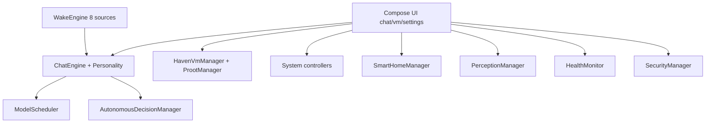

# JARVIS 对齐与补全

Feature Name: jarvis-completion
Updated: 2026-10-30

## Description

在已导入的 Android 工程上，按规格书分区把占位实现替换为真实路径，打通构建/测试，最终交付 Debug APK。权威需求见 `docs/实施计划.md` 与本目录 `requirements.md`。

## Architecture

分层：UI → 领域 Manager（Koin 单例）→ Android 平台 API / 文件 / 进程。失败一律向上返回错误文案。

## Components and Interfaces

- `ChatEngine`：多轮上下文、人格、翻译/检索注入、流式生成
- `ModelScheduler`：四档优先级与导入模型注册
- `WakeEngine`：唤醒源聚合，权限失败隔离
- `ProotManager` / `HavenVmManager`：真实 PRoot 生命周期
- `PermissionManager`：运行时权限门面
- `CryptoManager` + `SecureStorage`：AES-256-GCM 与凭据
- `KeepAliveService`：前台保活

## Data Models

人格、会话消息、虚拟机、设备、记忆条目、插件元数据均已有 Kotlin data class；本阶段补持久化缺口（记忆全文、提醒落盘、设备分组）而不改包名。

## Correctness Properties

- P1：无模型文件时 generate 失败
- P2：无 rootfs 时终端不产生伪造命令输出
- P3：无权限时电话/短信/擦除失败
- P4：云 URL 为空时同步禁用
- P5：RESERVED 功能不返回假成功

## Error Handling

统一中文错误：未授予权限、未检测到设备、组件未安装、网络失败、校验失败。禁止吞异常后 `return true`。

## Test Strategy

JVM 单元测试覆盖纯逻辑；集成测试覆盖对话管线、VM 子系统、唤醒管线、SmartHub。阶段结束必须 `testDebugUnitTest` 全绿。仪器测试与真机列在 `docs/release_checklist.md`。

## References

- docs/JARVIS_产品规格书.md
- docs/JARVIS_产品计划书.md
- docs/JARVIS_补充计划.md
- docs/JARVIS补充内容规格书.md
- docs/实施计划.md
