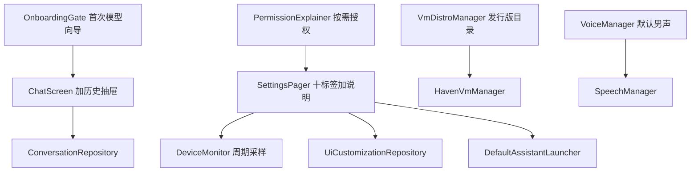

# JARVIS 实机体验修复

Feature Name: jarvis-runtime-fix
Updated: 2026-11-05

## Description

对照用户 9 条实机反馈与规格书 3.1/3.3、计划书分区 3/4/11、补充规格 REQ-02/05/09，修复设置页、主题、权限、首次模型引导、虚拟机发行版、默认男声与聊天记录。本轮不重做已闭环的对话调度、唤醒保活、失败关闭与 Debug 打包纪律。

## Architecture

分层保持 UI → Manager → 平台 API。失败返回中文错误。

## Components and Interfaces

- `SettingsScreen`：`HorizontalPager` 十页；每页标题 + 一行规格说明；`selected` 写入 `jarvis_settings` SharedPreferences。
- `GeneralTab`：新增「一键设为默认 AI 助手」，Intent `android.settings.VOICE_INPUT_SETTINGS`（失败则 `ACTION_VOICE_INPUT_SETTINGS` 回退）。
- `DeviceMonitor`：`start()/stop()` 协程每 2s 读 `/proc/stat` 计算 CPU%；`refresh()` 保留给手动。
- `JarvisTheme`：`customColor` 同时写入 `primary` 与 `secondary`；聊天/设置/虚拟机共用同一 `JarvisTheme`。
- `MainActivity`/`NavHost`：设置路由 `saveState/restoreState`；去掉虚拟机/设置页多余 TopAppBar 与 Scaffold 双重 padding。
- `OnboardingGate`：无本地模型时全屏向导，用户点「开始下载」才调 `ModelDownloadManager`；超时 30s 失败关闭。
- `PermissionExplainer`：危险权限仅在功能点击后 `rememberLauncherForActivityResult`。
- `VmDistroManager.buildCatalog()`：替换为用户清单 12 条（6 个 aarch64 + 6 个 x86_64 模拟标记）。
- `ProotManager`：随包/缓存二进制就绪即 `isReady=true`，去掉强制初始化页。
- `VoiceManager`：默认 `jarvis_zh_cn` 男声；源失败走系统中文 TTS。
- `ChatScreen`：历史列表接 `ConversationRepository`。

## Data Models

- `SettingsTabSpec(id, title, description)`
- `DistroInfo` 增加 `emulatedX86: Boolean`、`unavailableReason: String?`
- `OnboardingState(needed, selectedModelId, error)`
- 对话仍用现有 `Conversation` / `ConversationDto`

## Correctness Properties

- P1：冷启动不调用 `ActivityCompat.requestPermissions` 批量列表
- P2：无模型且用户未确认下载时不发起 HTTP
- P3：CPU 采样来自两次 `/proc/stat` 差分，缺文件不显示 0%
- P4：设置标签索引跨导航恢复
- P5：x86_64 条目在非模拟就绪设备上不可点下载

## Error Handling

中文错误：无法读取 CPU 使用率、未授予权限、模型下载超时、声线源不可达、PRoot 未安装、当前设备无法模拟 x86_64。禁止吞异常后假成功。

## Test Strategy

JVM 单测覆盖 CPU 差分计算、设置索引持久化逻辑、发行版目录条目、权限门面「启动不请求」、向导未确认不下载、声线性别/默认 id。阶段结束 `testDebugUnitTest` 全绿后 `assembleDebug` 打 7z。

## Scope Cut

纳入：设置说明与横滑、默认助手按钮、CPU/设备实时、主题色生效、状态栏空白、按需权限、首次模型向导、发行版清单与 PRoot 免初始化、默认男声、聊天历史。

舍去：GPU 占用率（无稳定公开 API）、Haven Wayland 桌面、关机语音唤醒、Release 包、复制 Kai 源码、科幻 RESERVED。

## References

- docs/JARVIS_产品规格书.md 3.1 3.3 4.3
- docs/JARVIS_产品计划书.md 分区 3.11 4 11
- docs/JARVIS补充内容规格书.md REQ-02 REQ-05 REQ-09
- docs/JARVIS_人格灵魂描述.md 1.1 声线
- docs/参考项目说明.md（Kai 仅参考布局，Haven 仅参考 PRoot）
