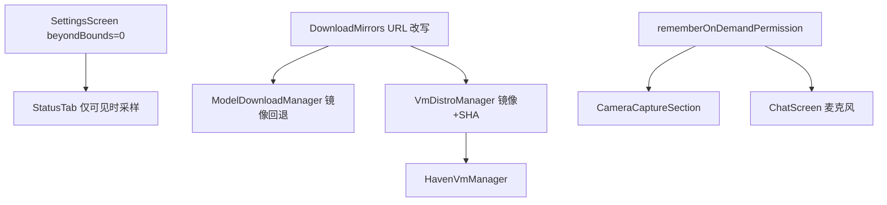

# JARVIS 卡顿、镜像与 Haven 权限修复

Feature Name: jarvis-perf-mirror-haven
Updated: 2026-11-07

## Description

对照用户 4 条实机反馈：设置页卡顿、下载超时后国内镜像自动切换、Haven 式 PRoot 镜像清单、危险权限先说明再系统弹窗。本轮不重做已闭环的十标签、主题色、男声与聊天历史。

## Architecture

分层保持 UI → Manager → 平台 API。失败返回中文错误。

## Components and Interfaces

- `DownloadMirrors`：纯函数，把 huggingface.co 改写为 hf-mirror.com，把 github.com / raw.githubusercontent.com 改写为 ghproxy.net 前缀；超时/失败后调用方依次尝试原 URL 与镜像 URL。
- `ModelDownloadManager.downloadModel`：对每个模型 URL 列表（主源 + 镜像）依次下载；连接/读取超时切下一源；进度状态写入 `currentUrl` 与中文提示。
- `ProotManager.downloadToFile`：connect 15s / read 30s；抛出超时后由上层切镜像。
- `VmDistroManager.downloadDistro`：`urls = downloadUrl + mirrorUrls + DownloadMirrors.expand(downloadUrl)` 去重后依次尝试。
- `OnboardingGate.TIMEOUT_MS`：改为 0（不整包超时）；向导去掉 `withTimeoutOrNull`，失败走镜像错误文案。
- `SettingsScreen.HorizontalPager`：`beyondBoundsPageCount = 0`；仅当前页组合内容。
- `StatusTab`：采样循环仅在该页可见时运行，`refresh()` 放到 `Dispatchers.IO`。
- `ServiceTab`：通过 Koin `get<ModelDownloadManager>()` 复用单例。
- `CameraCaptureSection` / `ChatScreen`：统一走 `rememberOnDemandPermission`。
- `VmDistroManager.buildCatalog()`：补 Kali（SHA-256 已有常量）、Rocky/Windows 为导入项（`unavailableReason` 引导导入）。

## Data Models

- `ModelConfig.mirrorUrls: List<String>`
- `ModelDownloadState.errorMessage` 可含「主源超时，正在切换国内镜像」
- `DistroInfo` 已有 `mirrorUrls` / `checksumSha256` / `unavailableReason`

## Correctness Properties

- P1：HuggingFace URL 经 `DownloadMirrors.hfMirror` 后主机为 `hf-mirror.com` 且路径不变
- P2：GitHub URL 经 `DownloadMirrors.ghProxy` 后以 `https://ghproxy.net/` 为前缀
- P3：主源失败后至少再尝试一个国内镜像 URL
- P4：状态页不可见时不调用 `DeviceMonitor.refresh`
- P5：相机/麦克风点击路径包含 `rememberOnDemandPermission` 或同等说明对话框
- P6：Kali 条目 `checksumSha256` 等于 `KALI_MINIMAL_ARM64_SHA256`

## Error Handling

中文错误：主源超时正在切换国内镜像、全部镜像均失败、发行版缺少 SHA-256 校验和拒绝安装、未授予权限、Windows/Rocky 请导入镜像。禁止吞异常后假成功。

## Test Strategy

JVM 单测覆盖镜像 URL 改写、超时后切换下一 URL、发行版 Kali SHA 与 Rocky/Windows 导入提示、启动路径不批量权限。阶段结束 `testDebugUnitTest` 全绿后 `assembleDebug` 打 7z。

## Scope Cut

纳入：卡顿收敛、镜像 failover、Haven 清单补 Kali/Rocky/Windows 导入、权限说明弹窗补相机与聊天麦克风。

舍去：Wayland/VNC、Windows Hypervisor、关机唤醒、Release 包、科幻 RESERVED。

## References

[^1]: (Website) - [Haven PRoot](https://github.com/GlassOnTin/Haven)
[^2]: (Filename) - [实施计划第 8 节](docs/实施计划.md)
