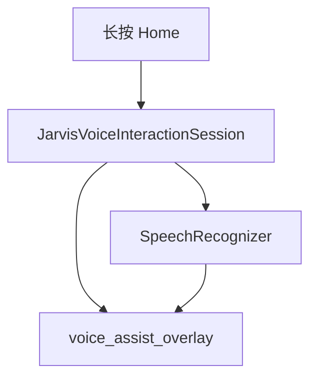

# JARVIS 默认助手 overlay 听写（A1）

Feature Name: jarvis-assistant-parity
Updated: 2026-11-08

## Description

长按 Home 已能弹出 JARVIS overlay。本轮只把该 overlay 接到系统 `SpeechRecognizer`：听写、RMS 声纹、中文失败。不接 ChatEngine、不读 AssistStructure。

## Architecture

失败返回中文错误。禁止 `startVoiceActivity` / `MainActivity`。

## Components and Interfaces

- `JarvisVoiceInteractionSession.onShow`：通知 `HomeLongPressDetector`，检查麦克风权限后 `SpeechRecognizer.startListening`
- `onRmsChanged`：归一化后写入 `VoiceWaveformView.rms`
- `onPartialResults` / `onResults`：更新 `assist_hint`
- `onError`：映射为中文，写入 hint，声纹归零
- `onHide`：`stopListening` + `destroy`

## Correctness Properties

- P1：会话源码包含 `SpeechRecognizer` 与 `voice_assist_overlay`
- P2：会话源码不含 `startVoiceActivity`
- P3：无麦克风权限时文案为「未授予麦克风权限」

## Error Handling

中文错误：未授予麦克风权限、语音识别不可用、未识别到语音、语音输入超时。禁止假成功。

## Scope Cut

纳入：A1 overlay 听写。

舍去：A2 overlay 回答、A3 识屏、B1 建议卡片、B2 默认助手引导、C1 overlay 多模态、Release、关机唤醒。
