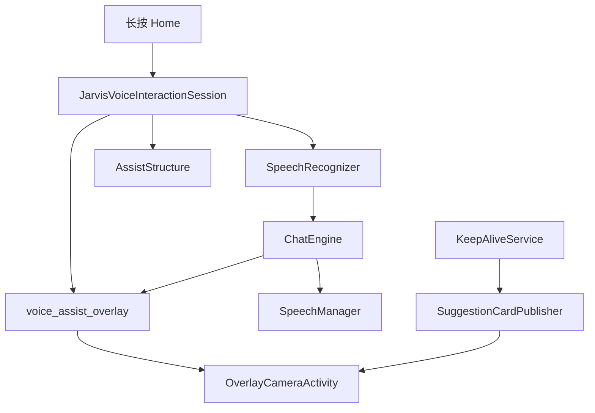

# JARVIS 默认助手 A1–C1

Feature Name: jarvis-assistant-parity
Updated: 2026-11-10

## Description

长按 Home overlay 听写（A1）已落地。本轮把识别结果交给 ChatEngine 并 TTS（A2），读取 AssistStructure（A3），保活循环推建议卡片（B1），通用页检测默认助手（B2），overlay/建议卡片打开识物与扫文档（C1）。禁止拉起主界面，禁止假成功。

## Architecture

失败返回中文错误。禁止 `startVoiceActivity` / `MainActivity`。

## Components and Interfaces

- `JarvisVoiceInteractionSession.onShow`：通知 HomeLongPressDetector，启动 SpeechRecognizer
- `onHandleAssist`：遍历 AssistStructure，写入 screenContext
- `onResults`：非空文本走 `OverlayReplyCoordinator` + `ChatEngine.sendUserMessage` + `SpeechManager.speak`
- `KeepAliveService.startAutonomousLoop`：`generateContextualSuggestions` 后 `SuggestionCardPublisher.publish`
- `GeneralTab`：`HomeLongPressDetector.isDefaultAssistant()`，未设置时引导系统设置
- `OverlayCameraActivity`：TakePicturePreview + `CameraCaptureSession` 识物/扫文档

## Correctness Properties

- P1：会话源码包含 SpeechRecognizer、ChatEngine、onHandleAssist、OverlayCameraActivity
- P2：会话源码不含 startVoiceActivity / MainActivity
- P3：无麦克风权限时文案为「未授予麦克风权限」
- P4：空屏幕文本不得伪造内容
- P5：空建议或重复指纹不得再发通知
- P6：无图像时返回 CameraCaptureSession.NO_IMAGE

## Error Handling

中文错误：未授予麦克风权限、语音识别不可用、对话引擎不可用、回答失败、未能读取当前屏幕内容、未授予相机权限、未采集到图像、识物引擎不可用。禁止假成功。

## Scope Cut

纳入：A1–C1。

舍去：Release、关机唤醒、科幻 RESERVED、Wayland 桌面、Windows Hypervisor。
